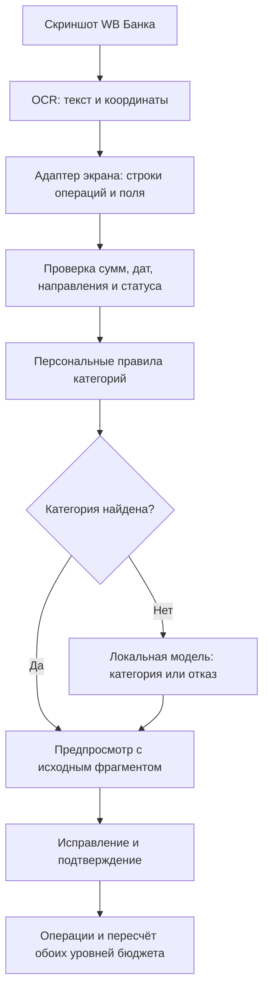

# Импорт банковских скриншотов: архитектура и выбор решения

Дата исследования: 14 октября 2026 года. Статус: теоретическое проектирование. Реализация OCR, установка моделей, новые маршруты и миграции в этой задаче не выполняются.

Исходные условия: WB Банк; собственный сервер с 6 ядрами, 16 ГБ RAM и SSD 500 ГБ, без GPU. Основной backend и финансовые правила остаются на Go. Готовая версия приложения зафиксирована коммитом `e67a281`.

## 1. Рекомендуемое решение

Использовать последовательность **OCR с координатами → адаптер экрана WB Банка → проверка финансовых полей → персональные правила категорий → небольшая локальная модель для неоднозначных описаний → предпросмотр → подтверждение**.

Главное улучшение относительно простой связки OCR + LLM — разделить извлечение фактов и предложение категории, сохранять доказательства из изображения и запоминать подтверждённые пользователем правила. Повторяющемуся получателю обычно достаточно персонального соответствия. Модель нужна для нового описания, которое правила не объясняют.

Это архитектурная рекомендация, а не результат испытаний: реальные скриншоты WB Банка пока не предоставлены. Нельзя утверждать, что конкретная OCR-модель или экранный адаптер уже распознаёт их с заданной точностью.

## 2. Что именно извлекается

Сначала поддержать один согласованный вид экрана WB Банка: историю операций. Детали отдельной операции — второй вариант того же адаптера. Главный экран с остатком, графики расходов, уведомления и скриншоты других банков требуют отдельных правил.

Каждая предполагаемая операция содержит:

- фрагмент исходного изображения и координаты строки;
- название получателя/магазина, описание и банковскую категорию, если она видима;
- сумму и направление движения денег; валюту всегда считать RUB по требованию владельца, не извлекать её через OCR;
- дату и видимый статус операции;
- исходный текст каждого финансового поля и причины сомнения;
- предложенную категорию, способ её выбора и возможное совпадение с ранее внесённой операцией.

Распознавание OCR всего экрана само по себе не выделяет операции. Адаптер должен группировать блоки по их расположению: сумма относится к своей строке, заголовок даты — к группе под ним. Общий баланс, месячный итог, кнопки, реклама и другие числа не становятся операциями. Обозначение комиссии на экране деталей не должно второй раз прибавляться к уже включающей её сумме.

Привязка строится по расположению, текстовым якорям и типу экрана, а не только по фиксированным координатам. Светлая/тёмная тема, размер шрифта и разрешение входят в проверяемые варианты. Неизвестный вид экрана получает состояние «Нужна проверка».

## 3. Деньги, даты и тип операции

Денежные строки нормализуются Go-кодом в целые копейки без float: например, `−1 250,50 ₽` даёт модуль суммы `"125050"` и направление расхода. Допускается нормализация пробелов и известных разделителей; исправления цифр вроде `O → 0` нельзя применять незаметно к сомнительному финансовому полю.

Направление определяется видимым знаком и смысловыми метками операции. Цвет может быть дополнительным сигналом конкретного проверенного адаптера. Категория «Зарплата» не является доказательством зачисления, а красный цвет сам по себе не доказывает расход. При конфликте сигналов пользователь подтверждает направление.

Даты «Сегодня» и «Вчера» требуют даты съёмки. Дата загрузки старого скриншота её не заменяет. Предлагать владельцу подтвердить дату съёмки или период; отсутствующий год также отмечать как восстановленный из контекста. Для календарных правил использовать часовой пояс профиля. Даты до начала учёта и будущие даты проверять по существующим правилам приложения.

Обрезанную первую/последнюю строку, скрытые копейки и неоднозначную дату нельзя пометить готовыми к импорту без исправления. Валюта фиксирована RUB: отсутствие или искажение знака ₽ не требует отдельного подтверждения валюты. Ожидающая/отклонённая операция не должна автоматически становиться завершённой. Если статус не показывается, это ограничение фиксируется для выбранного вида экрана, а не заменяется выдуманным «Выполнено».

Модель категоризации получает уже извлечённое описание. Она не пересчитывает суммы, не устанавливает дату и не меняет направление. Подтверждённая категория не снимает сомнение в распознанной сумме.

## 4. Семантически сложные операции

| Случай | Поведение первого импорта |
| --- | --- |
| Покупка в понятном магазине | Предложить категорию по персональному правилу, банковской метке или модели |
| «Wildberries» без состава покупки | Возможно предложить широкую категорию «Покупки»; одежду, продукты или технику без деталей определить нельзя |
| Перевод физическому лицу | Не считать автоматически арендой, подарком или оплатой услуги; запросить выбор владельца |
| Перевод между своими счетами | Отметить для проверки области учёта и принадлежности счетов |
| Возврат покупки | Отдельно отметить возврат; в текущем MVP запись доходом увеличит баланс, но не уменьшит расходы бюджета |
| Кэшбэк/проценты | Предложить доход при подтверждённом зачислении; конкретную категорию выбирает владелец |
| Снятие/внесение наличных | Проверить, входит ли наличность в общий учитываемый баланс; не назначать расход/доход только по знаку |
| Комиссия | Учитывать отдельно только если это отдельное списание, а не пояснение к общей сумме |
| Отмена/возврат резервирования | Проверить связь с исходной записью; не создавать повторный доход автоматически |

До реализации нужно зафиксировать область кошелька: все личные средства или только WB-счёт. В общем учёте перенос между двумя включёнными источниками не меняет общий баланс. При учёте только WB-счёта такой перенос меняет банковский остаток, но не является экономическим доходом/расходом. Текущая модель приложения не содержит отдельных счетов и переводов, поэтому сомнительные перемещения отправляются на ручную проверку. Нельзя обещать сверку банковского остатка по неполному скриншоту истории.

Примеры в таблице условные; фактические подписи и статусы WB Банка предстоит проверить на образцах.

## 5. Как выбирать категорию

Приоритеты:

1. Явное правило владельца для этого профиля, банка, получателя и направления.
2. Подтверждённое соответствие банковской категории категории профиля, когда метка действительно видима.
3. Подтверждённые похожие операции владельца и узкие проверенные правила.
4. Небольшая модель, которая выбирает из актуальных категорий подходящего типа или возвращает `null`.
5. Ручной выбор при недостатке информации.

После исправления предложить действие «Запомнить для этого получателя». Оно создаёт редактируемое персональное правило; одна необычная покупка не должна молча менять все будущие операции. Для магазина с разными видами товаров правило может быть слишком широким — разрешить оставить решение только для этой записи.

Нормализация получателя удаляет лишь проверенный технический шум. Нельзя объединять разные магазины по общему слову «магазин» или разные переводы по метке «СБП». Правила не переносятся между профилями автоматически. Архивные категории не предлагаются новым операциям.

Модели передавать описание платежа, видимую банковскую метку, список разрешённых ID/названий категорий, их пользовательские пояснения и несколько подтверждённых примеров. Сумма, баланс, телефон, номер карты и полный скриншот для текстовой классификации не нужны. Историю владельца целиком в контекст не отправлять.

Результат — ID существующей категории или `null`, короткое основание и признак неоднозначности. Ограничить форму ответа простой JSON-грамматикой с enum разрешённых ID, а затем повторно проверить в Go. `llama.cpp` поддерживает преобразование части JSON Schema в грамматику; это обеспечивает форму ответа, но не истинность категории. Поддержку выбранной схемы необходимо проверить. [Документация llama.cpp](https://github.com/ggml-org/llama.cpp/blob/master/grammars/README.md).

Число «уверенность 98%», которое модель написала о себе, не является измеренной вероятностью. Метки качества определять по проверкам полей, происхождению правила и результатам отдельной размеченной выборки. OCR-score также не является вероятностью правильности всей операции.

Сначала достаточно словаря правил и нескольких примеров. Дообучение модели и отдельная база векторов не нужны. При накоплении данных можно отдельно сравнить простое текстовое ранжирование/классификатор с LLM; персональные исправления сохраняются независимо от версии модели.

## 6. OCR и локальная модель

### OCR: основной кандидат и контрольный вариант

Основной кандидат — **PP-OCRv5 mobile**: детектор текста и распознаватель `eslav` для русского/белорусского/украинского и английского. RapidOCR перечисляет ONNX-вариант этого распознавателя. Это важно: нельзя брать произвольную OCR-модель с поддержкой только латиницы/китайского и ожидать чтение русских банковских экранов. [Поддерживаемые языки PaddleOCR](https://github.com/PaddlePaddle/PaddleOCR/blob/main/docs/version3.x/algorithm/PP-OCRv5/PP-OCRv5_multi_languages.en.md), [модели RapidOCR](https://rapidai.github.io/RapidOCRDocs/main/model_list/).

Контрольный вариант — **Tesseract с русским и английским языками**. Его стоит включить в короткое сравнение на тех же скриншотах: если он обеспечивает нужную точность полей, более простой нативный запуск может оказаться достаточным. Русские языковые данные перечислены в официальной документации. [Tesseract traineddata](https://tesseract-ocr.github.io/tessdoc/Data-Files.html).

Для PP-OCR планируется нативный worker C++ с ONNX Runtime, вызываемый Go. RapidOCR описывает межъязыковые реализации, а ONNX Runtime предоставляет C/C++ API. Совместимость конкретного PP-OCRv5 `eslav`, словаря символов и preprocessing/postprocessing выбранного C++ worker нужно проверить отдельно: наличие ONNX-файла не делает всю интеграцию готовой. [RapidOCR](https://github.com/RapidAI/RapidOCR), [ONNX Runtime C/C++](https://onnxruntime.ai/docs/get-started/with-c.html).

### Категоризация: два кандидата для сравнения

| Кандидат | Назначение и основание выбора |
| --- | --- |
| Qwen3-4B-Instruct-2507, Q4_K_M | Основной кандидат текстовой классификации: 4B, режим без развёрнутого thinking; сравнить точность категорий и CPU-задержку |
| Qwen3.5-2B, Q4_K_M | Более компактный кандидат; имеет поддержку изображений, но в основной схеме вызывается для текста. Проверить, оправдывает ли меньший размер качество на русских описаниях |

Это кандидаты, а не утверждение о победителе. Официальные карточки подтверждают типы/размеры моделей; обе опубликованы с Apache-2.0. Карточка 4B отдельно указывает non-thinking режим, карточка 2B — архитектуру с vision encoder. Конкретную GGUF-квантизацию, runtime и совместимость фиксировать после проверки, не выбирать случайную стороннюю сборку по названию. [Qwen3-4B-Instruct-2507](https://huggingface.co/Qwen/Qwen3-4B-Instruct-2507), [Qwen3.5-2B](https://huggingface.co/Qwen/Qwen3.5-2B).

Запуск модели — через `llama-server` на локальном интерфейсе/внутренней Docker-сети. Go управляет задачами и проверяет результаты; Python-backend приложения не появляется. Модель не получает инструменты, прямой доступ к БД или право создавать операции. Текст из скриншота считается данными платежа, включая встречающиеся в нём инструкции.

## 7. Почему не отправлять весь скриншот сразу в vision-модель

| Вариант | Преимущества | Ограничения | Решение |
| --- | --- | --- | --- |
| OCR + адаптер + правила | Проверяемые поля, координаты и простые повторные операции | Новые неясные описания требуют ручного решения | Обязательная основа |
| OCR + правила + текстовая модель | Использует контекст категории и исправления владельца; модель вызывается выборочно | Ошибки OCR остаются; категория может быть неоднозначной | Рекомендуемый рабочий поток |
| Одна vision-модель извлекает всё | Может понимать расположение и изображение напрямую | Единая ошибка может затронуть сумму, знак и категорию; нагрузку на CPU надо измерять | Сравнительный эксперимент или обработка трудного фрагмента |

Qwen3.5-2B действительно допускает входные изображения, поэтому отдельный OCR технически не обязателен для такого эксперимента. [Официальная карточка модели](https://huggingface.co/Qwen/Qwen3.5-2B).

Если vision-вариант покажет лучшую точность обязательных полей при приемлемой задержке, его можно выбрать или применять к сомнительным фрагментам. Сначала сравниваются реальные ошибки и время, а не размер модели и рекламные OCR-бенчмарки. В обоих вариантах сохраняются проверка Go-кодом, происхождение полей и подтверждение пользователя.

## 8. Ресурсы сервера и выполнение

16 ГБ RAM позволяют поставить на сравнение небольшие квантованные модели и OCR; это предварительная инженерная оценка, а не измерение на сервере владельца. Неизвестны модель CPU, поколение, инструкции и нагрузка других сервисов.

Стартовые ограничения для испытания: одна задача импорта одновременно, до 4 CPU-потоков модели, небольшой контекст порядка 4K токенов, короткий ответ, без длинного reasoning. OCR и LLM обрабатывают пакет последовательно, чтобы не создавать неконтролируемую конкуренцию за все 6 ядер. Предварительный предел RAM процесса модели — 6 ГиБ; его нужно уточнить по фактическому пику. Остальная память остаётся ОС, PostgreSQL, приложению, OCR и другим сервисам.

Обрабатывать только неоднозначные строки, группируя несколько в короткий вызов с явными ID строк. Порядок и полноту ответа проверять в Go. При недоступной модели показать уже извлечённые операции и ручной выбор категории; весь импорт не должен исчезать.

Использовать сохраняемую очередь в PostgreSQL, а не добавлять Redis/Kafka для одного владельца. Worker получает задачу с ограниченным lease; после перезапуска зависшая работа возобновляется. Разделить состояния загрузки, распознавания, предпросмотра, подтверждения, завершения, ошибки и отмены. Повтор inference не создаёт финансовых операций.

Предварительная цель UX — предпросмотр обычного экрана до 10–20 видимых операций примерно за 30 секунд. Это целевой бюджет, не обещанный результат; отдельно измерить холодный/прогретый запуск и p50/p95. При превышении бюджета уменьшить модель/число спорных строк или оставить OCR + ручной выбор.

## 9. Дубли и подтверждение

Проверять дубли на трёх уровнях:

1. SHA-256 файла в пределах профиля: повторная загрузка того же снимка не запускает новый независимый импорт подтверждённых строк.
2. Проверенный банковский идентификатор операции и источник/счёт, если идентификатор действительно виден и надёжно прочитан.
3. Сходство даты, суммы, направления, получателя и времени — только кандидат дубля, включая ранее внесённые ручные операции и перекрывающиеся скриншоты.

Две одинаковые покупки в одном кафе в один день возможны. Совпадение суммы/даты/описания не является основанием автоматически удалить одну из них. При неполных данных показать пару записей и позволить владельцу выбрать «Уже внесено» или «Отдельная операция».

Предпросмотр показывает исходную строку рядом с полями, предложенную категорию и понятный статус: готово, исправить поля, выбрать категорию, возможный дубль, пропустить. Кнопка подтверждения работает только для выбранных валидных строк. Никакая уверенность модели не заменяет это подтверждение в первой версии.

Подтверждение небольшого выбранного пакета — атомарная транзакция: повторно проверить профиль, категории, даты и версию черновика; записать операции с постоянными UUID строк и связь с импортом; зафиксировать результат. Повтор после потери ответа возвращает те же операции. Удаление уже импортированной операции не должно разрешать её тихое повторное создание тем же импортом. Общий и категорийные бюджеты используют текущие серверные расчёты.

## 10. Изменения приложения при будущей реализации

Понадобятся концептуальные сущности: пакет импорта, извлечённая строка с доказательствами полей, соответствие строка → операция, персональное правило категории. Хранить версии адаптера, OCR-моделей/словари, LLM/prompt и факт исправления владельцем. Числа и подтверждённые поля сохраняются независимо от модели.

Текущая БД допускает только `source=manual`; API ручной операции также не принимает произвольный `source`. Для импорта потребуется отдельная миграция и общий слой создания операций, сохраняющий существующие проверки и блокировки. Нельзя просто отправлять OCR-результаты в текущий ручной endpoint с лишними полями.

Будущие операции API: загрузить файл, прочитать состояние/черновики, исправить строки, подтвердить выбранные строки, отменить/удалить исходный файл. Точные маршруты и OpenAPI-схемы определить после проверки формата WB; текущий контракт в этой задаче не меняется.

Первоначально принимать PNG/JPEG/WebP с ограничениями байтов и числа пикселей, например 10 МБ и 20 Мп, уточнив их для длинных экранов. Проверять реальное декодирование и размеры, а не только расширение. Оригинальное цветное изображение сохранять до подтверждения; производные кропы привязывать к нему. Шифры счетов/карт и лишние области не включать в запрос классификатора.

Обработка локальная. Исходные изображения и полный OCR-текст не пишутся в HTTP-логи и не отправляются внешнему провайдеру. Предложенный срок хранения неподтверждённых файлов — 7 дней; после подтверждения оригинал можно удалить. В БД остаются минимальные подтверждённые поля, связь с операцией и идентификаторы, необходимые для повторов/дублей. Не включать исходные изображения в долгоживущие backup автоматически, если заявлено их удаление.

## 11. Как проверить решение до выбора стека

После завершения теоретической стадии собрать с согласия владельца 30–50 обезличенных экранов WB Банка и разметить видимые операции. Нужны оба вида экрана, темы, разная плотность/масштаб, доходы, покупки, переводы, возвраты, комиссии, обрезанные строки и перекрытия. Обезличивание должно сохранять расположение и формат текста; заменённые описания учитывать при оценке категорий.

Разделить настройку и контроль по исходным скриншотам: почти одинаковые/перекрывающиеся снимки не должны оказаться в разных частях. Отдельно оценить известных и новых получателей, чтобы память правил не маскировала качество модели.

Измерить:

- полноту выделения видимых операций и ложные операции из заголовков/баланса;
- точное совпадение суммы с копейками, направления и даты; валюта фиксирована RUB;
- точность категории, долю отказов и покрытие предложениями; результаты правил и модели отдельно;
- долю строк, которые требуют исправления владельца, и время проверки пакета;
- ложные/пропущенные кандидаты дубля;
- p50/p95, холодный старт и пик RAM на реальном сервере.

Сравнить PP-OCRv5 и Tesseract на одинаковых изображениях; затем добавить два текстовых кандидата и эксперимент с прямой vision-моделью. Условия выбора: минимальные ошибки обязательных полей, приемлемая задержка и выигрыш по времени пользователя. Не выбирать более тяжёлую модель за улучшение общей текстовой метрики, если она путает знаки или ухудшает точность сумм.

Для первой версии подтверждение всех строк остаётся обязательным. Автоматическое принятие можно обсуждать отдельно после достаточной контрольной выборки; отсутствие ошибок на нескольких десятках снимков не доказывает их отсутствие в будущем.

## 12. Дальнейший порядок

1. Уточнить, что отражает кошелёк: все личные средства или только WB-счёт, и какой экран пользователь будет загружать чаще.
2. Получить обезличенные образцы и выбрать первый поддерживаемый формат WB.
3. Провести короткое сравнение извлечения полей и категорий по описанным метрикам.
4. Зафиксировать OCR/runtime/модель/квантизацию и их версии по результатам измерений.
5. Спроектировать контракт и сущности черновиков, предпросмотр и подтверждение.
6. Реализовать один формат с правилами и подключаемой моделью; расширять поддержку по реальным ошибкам.

Первый этап разработки должен дать удобный проверяемый черновик, который сокращает ручной ввод. Автоматическая запись без проверки и поддержка любого банковского экрана требуют отдельного решения.
